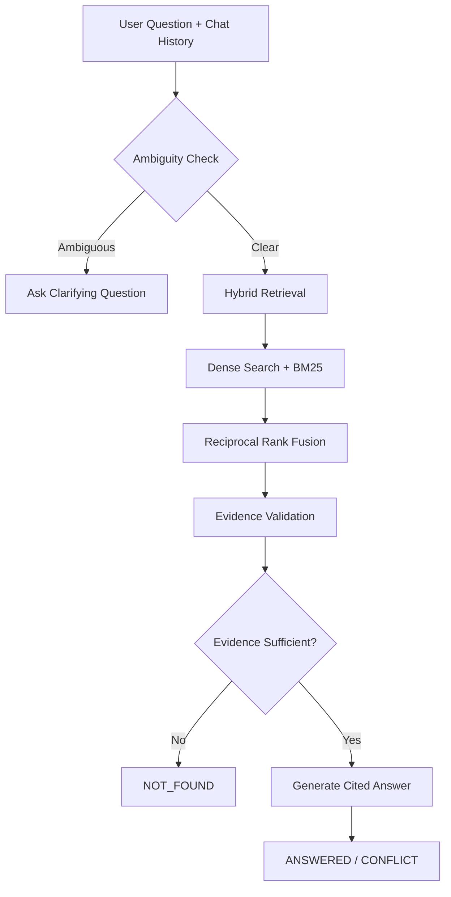

# 📚 Enterprise Documentation Q&A Assistant

Grounded Q&A over your company documents. Upload PDFs, HTML, Markdown or TXT files, ask questions, and get **cited answers**. The assistant asks a clarifying question when your query is unclear, returns **NOT_FOUND** when the evidence isn't available, and flags **CONFLICT** when documents disagree.

**Tech Stack:** LangChain · ChromaDB · all-MiniLM-L6-v2 · BM25 · Reciprocal Rank Fusion (RRF) · LangGraph · Groq · Streamlit

---

## ✨ Key Features

| Feature | Description |
|---|---|
| **Hybrid Retrieval** | Combines dense search (ChromaDB + MiniLM) and keyword search (BM25) using Reciprocal Rank Fusion (RRF, k=60). |
| **Persistent Storage** | Stores embeddings in `chroma_db/`, BM25 index in `storage/`, and uploaded documents in `data/`. |
| **Local Embeddings** | Uses MiniLM on CPU, requiring no embedding API key. |
| **Rich Metadata** | Each chunk stores document ID, title, source, page, section, type, version, effective date, upload date, status, chunk ID and start index. |
| **Ambiguity Detection** | Identifies unclear questions, missing entities and competing interpretations, then asks one clarifying question. |
| **Evidence Validation** | Checks whether retrieved passages actually contain enough evidence to answer the question. |
| **Conflict Detection** | Identifies contradictions between documents and considers version, effective date and status when supported by metadata. |
| **Source Citations** | Provides source document, page, section and expandable evidence excerpts. |
| **Honest Response Statuses** | Supports `AMBIGUOUS`, `NOT_FOUND`, `ANSWERED` and `CONFLICT`. |
| **Conversation Memory** | Uses the last approximately 5000 characters of conversation history to understand follow-up questions. |

---

## 🔄 Workflow

### 1. Document Ingestion

```text
Upload Documents
       ↓
Parse (PDF / HTML / Markdown / TXT)
       ↓
Clean Document Content
       ↓
Detect Section Headings
       ↓
Chunk Documents (850 characters, 140 overlap)
       ↓
Generate Embeddings (MiniLM)
       ↓
Store in ChromaDB
       ↓
Build BM25 Index
       ↓
Persist Index in Storage
```

### 2. Question Answering Pipeline

The application uses **LangGraph** to manage the question-answering workflow.



---

## 🚀 Installation and Setup

### Prerequisites

- Python 3.10 or Python 3.11
- Groq API Key
- Internet connection for downloading the embedding model

### Step 1: Clone the Repository

```bash
git clone https://github.com/your-username/your-repository.git
```

Navigate into the project directory:

```bash
cd your-repository
```

### Step 2: Create Virtual Environment

**Windows PowerShell:**

```powershell
python -m venv .venv
.venv\Scripts\Activate.ps1
```

### Step 3: Install Dependencies

```bash
pip install -r requirements.txt
```

### Step 4: Configure Environment Variables

Create a `.env` file in the root directory.

```env
GROQ_API_KEY=your_groq_api_key
GROQ_MODEL=openai/gpt-oss-20b
```

The model setting is optional and uses the above model by default.

**Important:** Never upload your actual API key to GitHub. Add `.env` to your `.gitignore` file.

### Step 5: Run the Application

```bash
streamlit run app.py
```

Open the local URL displayed in your terminal to access the application.

---

## 🧭 How to Use

1. **Upload Documents:** Open the sidebar and upload PDF, HTML, Markdown or TXT files.
2. **Configure Metadata:** Select document type, version, effective date and status.
3. **Upload:** Click the Upload button to process and index documents.
4. **Ask Questions:** Navigate to the Ask Questions tab and interact with your documents.
5. **View Diagnostics:** Expand the Diagnostics section to inspect ambiguity verdicts, validation results and retrieval counts.
6. **View Documents:** Navigate to the Documents tab to see indexed documents and their metadata.

---

## 🛠️ Technologies Used

| Technology | Purpose |
|---|---|
| Python | Core programming language |
| Streamlit | Interactive web application interface |
| LangChain | Document processing and LLM integration |
| LangGraph | Workflow orchestration |
| ChromaDB | Vector database for semantic retrieval |
| all-MiniLM-L6-v2 | Local text embedding model |
| BM25 | Keyword-based retrieval |
| Reciprocal Rank Fusion | Combines dense and keyword search results |
| Groq | LLM inference |
| PyPDF | PDF document parsing |
| BeautifulSoup | HTML document parsing |

---

## 📁 Project Structure

```text
Enterprise-Documentation-QA/
│
├── app.py                  # Streamlit application
├── rag_engine.py            # RAG pipeline and LangGraph workflow
├── requirements.txt         # Project dependencies
├── .env                     # API configuration (not committed)
├── .gitignore               # Ignored files
│
├── data/                    # Uploaded source documents
│
├── chroma_db/               # Persistent vector database
│
└── storage/                 # BM25 index and stored records
```

---

## ⚠️ Limitations

- **No OCR:** Scanned or image-only PDFs do not produce extractable text.
- **Metadata Per Batch:** Different document versions should be uploaded separately to maintain their metadata.
- **Superseded Documents:** Superseded or archived chunks are not currently excluded through hard retrieval filters.
- **Chunk Size:** MiniLM supports a maximum of 256 tokens per input, so chunk size may need tuning.
- **LLM Validation:** Evidence validation is best-effort and should be tested with labelled examples covering answerable, ambiguous, unanswerable and conflicting questions.

---

## 🔮 Future Improvements

- User authentication and role-based access control.
- Document deletion and version lifecycle management.
- OCR support for scanned PDFs.
- Advanced metadata filtering.
- Automated evaluation using benchmark question sets.
- Improved retrieval and ranking strategies.

---

## 🎯 Project Objective

To build an intelligent enterprise documentation assistant that enables users to retrieve accurate information from company documents using natural language queries.

The system focuses on reliable retrieval, evidence-based answers, source citations, ambiguity handling and conflict detection to reduce unsupported or misleading responses.

---

**Built with Python, RAG, LangGraph, ChromaDB and Groq.**
